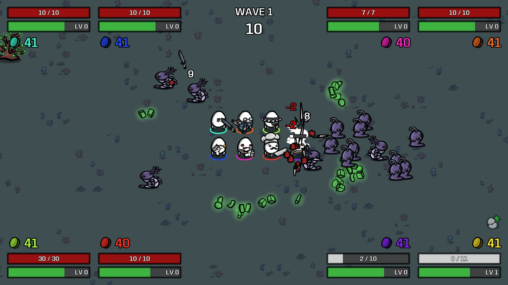

# Eight Player Coop for Brotato

Local co-op for up to **8 players on one PC**.

With 1–4 players Brotato looks and plays exactly like the normal game. From the 5th player on, every co-op screen switches to a layout made for 5–8 players: character and weapon selection, the in-wave HUD, level-ups and crates, the shop and the end-of-run screen.

## Install

Subscribe on the [Steam Workshop](https://steamcommunity.com/sharedfiles/filedetails/?id=3821320020) and start Brotato through Steam.

## How to play

- Turn on **Co-op** in character selection and hold Accept on each controller (Enter/Space for the keyboard player), as in normal co-op.
- Materials are shared between all players.
- Runs with 5–8 players can be saved and resumed.

### Controllers

One keyboard + mouse player and up to 7 gamepads. Windows only reports 4 Xbox-style controllers to a game, so for more than 4 gamepads mix in PlayStation, Switch or generic pads. If Steam Input turns those into Xbox controllers, turn Steam Input off for Brotato (Properties → Controller).

## Compatibility

| Mod | Status |
| --- | --- |
| Coop Trading | "Give to player" buttons work for all 8 players. The fix only switches on when Coop Trading is installed. |
| DmgMeter, Better Display | Their HUD elements line up for players 5–8. |
| ModOptions, Curse Indicator, Better Damage Numbers | Work as they are. |

Tested with Brotato 1.1.15 (with and without Abyssal Terrors) and ModLoader 6.3.0.

## Reporting bugs

Open an [issue](../../issues/new/choose) and include:
- how many players, and which controllers;
- your other active mods;
- the log file `%APPDATA%\Brotato\logs\godot.log` from right after the problem.

## Releasing an update

Workshop ID: **3821320020**. Upload the new zip with the Godot Workshop Utility (Brotato's "modding" beta branch) and enter this ID, so the existing Workshop item is updated instead of a new one being created.

## Repository layout

`mods-unpacked/PoppyTheDeveloPaw-EightPlayerCoop/` is the mod exactly as it ships. To build the Workshop zip, zip the `mods-unpacked` folder itself, so that the zip's root contains `mods-unpacked/`.

| Folder | Contents |
| --- | --- |
| `extensions/` | ModLoader script extensions of the game's scripts |
| `compat/` | Fixes for other mods, installed only when that mod is active |
| `ui/` | Layout helpers for the 5–8 player screens |

The mod contains no code or files from Brotato itself; it only extends the game's scripts at runtime through [Godot Mod Loader](https://github.com/GodotModding/godot-mod-loader). Please don't add Brotato's code or assets to this repository.

## License

[MIT](LICENSE) © PoppyTheDeveloPaw. This is a fan-made mod and is not affiliated with Blobfish.
